

  <picture>
    <source media="(prefers-color-scheme: dark)" srcset="branding/vonu-logo-white.svg">
    
  </picture>

<h1 align="center">Vonu PDF</h1>

  <b>Read, edit, sign, scan and organise PDFs on any Android phone, even a basic one.</b> 
  Version 1.1.2 · Android 7.0 and newer · No account · Your files stay on your phone

---

## About the app

Vonu PDF is an all-in-one PDF reader and editor for Android that anyone can use. It runs smoothly on basic phones with 1–2 GB of RAM. It is the first product in the Vonu family, which will later include Vonu Write, Vonu Post and Vonu Themes.

Everything happens on the phone. There is no account, no ads and no tracking, and documents never leave the device unless you share them. The only exception is optional Office-to-PDF conversion, which uses a Vonu server that you run yourself.

| Area | What you can do |
|---|---|
| **Read** | Smooth scrolling or page by page, Text view, Sepia and Night colours, search, select and copy text, bookmarks, contents, history, starred files, Read aloud |
| **Edit** | Highlight, underline, strike, pen, text, images, shapes, arrows, eraser, undo/redo |
| **Sign and fill** | Handwritten signatures (draw, type or photo), digital-ID signatures, fill PDF forms |
| **Scan** | Camera scanner, black-and-white clean-up, OCR so scans become searchable |
| **Organise** | Merge, split, reorder, rotate, extract or delete pages, compress, images ↔ PDF, text to PDF |
| **Protect** | Add or remove passwords (AES-256), true redaction, remove hidden data, edit document info, PDF/A check |
| **Advanced** | Compare two versions, batch-process many files, verify signatures, Office to PDF (with the server) |
| **Coming soon** | AI assistant: summaries, questions about a document, table extraction, translation |

### Requirements

| | |
|---|---|
| Android | 7.0 (API 24) or newer |
| Memory | Works from 1 GB RAM. Lite mode turns on by itself on basic phones |
| Permissions | No storage permission: Vonu only sees files you pick. Notifications are asked once, for batch jobs |
| Internet | Only for a one-time download of the OCR and language models (through Google Play services) and the optional server |
| Google Play services | Needed for the automatic document scanner and OCR. Without it, scanning still works with *Take a photo* or *From gallery* |

---

## User manual

  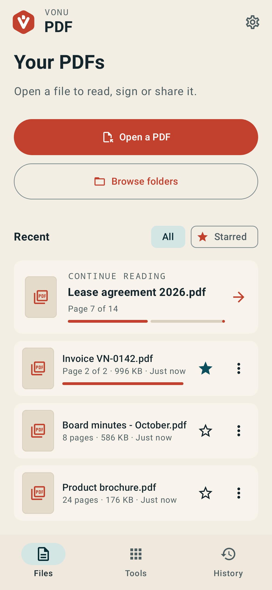
  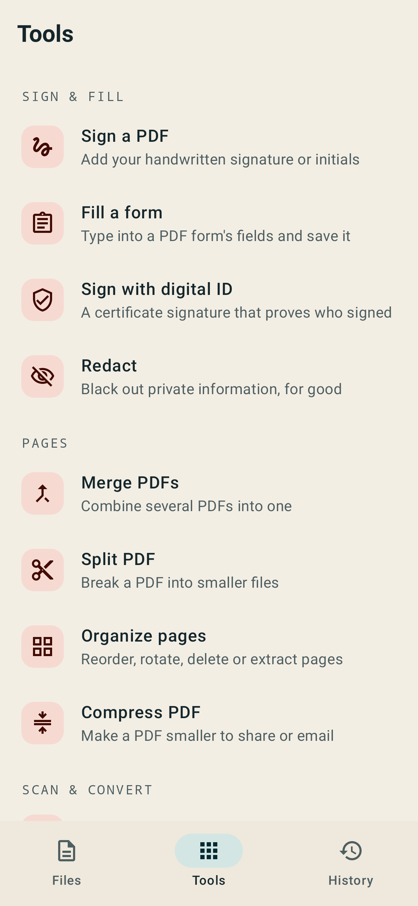
  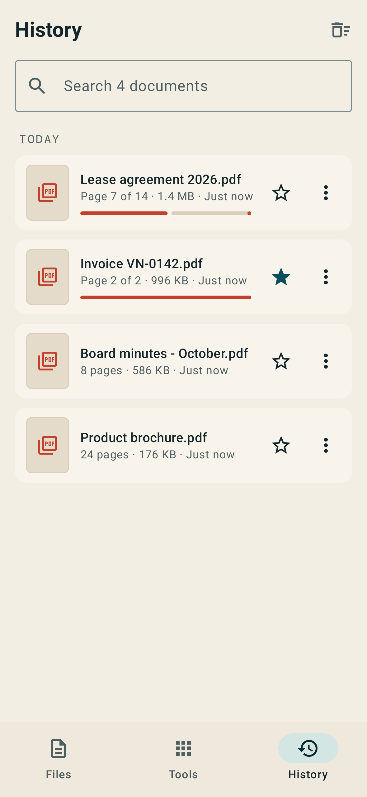
  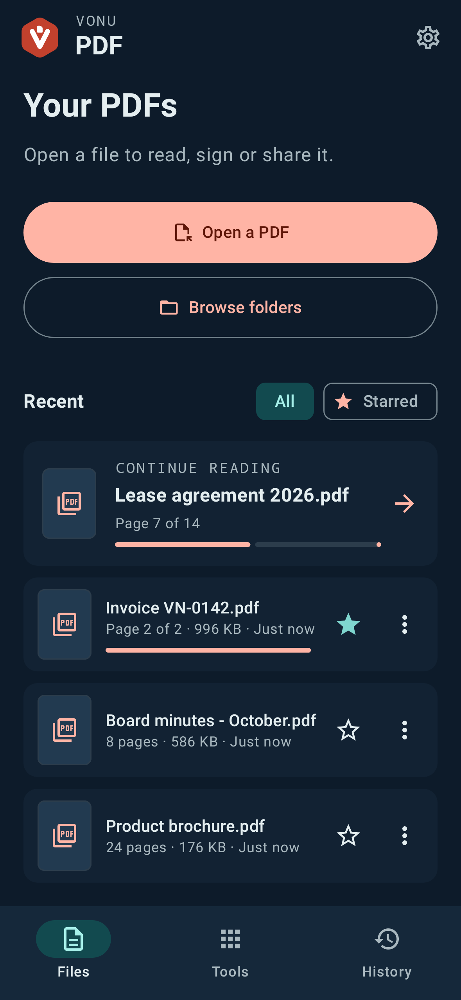

### Getting around

Vonu PDF has three tabs at the bottom. Everything else opens on top of them, and the back gesture takes you back.

| Tab | What it's for |
|---|---|
| **Files** | Open a PDF, browse a folder, and pick up the files you read last |
| **Tools** | Every tool, grouped by job: Sign & fill, Pages, Scan & convert, Protect, More |
| **History** | Every PDF you've opened, grouped by day, with search |

Settings is the ⚙ icon at the top of the Files tab.

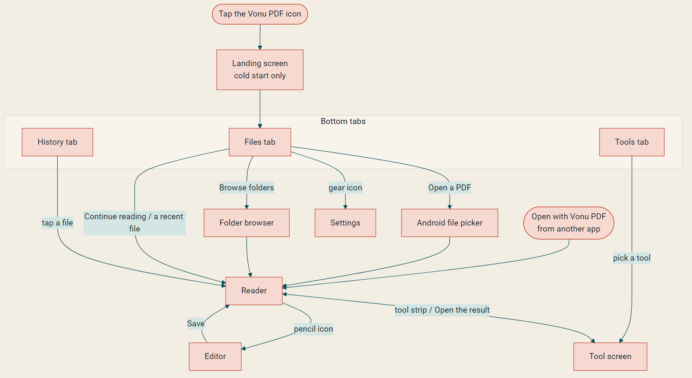

### Opening a PDF

Open a PDF in one of three ways:
- **Files → Open a PDF** opens Android's file picker.
- **Files → Browse folders**: pick a folder once and Vonu lists every PDF in it, with search and sort.
- **From another app** (Files, WhatsApp, email): tap the PDF and choose **Vonu PDF**.

Under **Recent**, the file you were reading last appears as **Continue reading** and takes you back to the page you left. Each file shows its page count (or where you are in it), its size and when you opened it. Tap ☆ to **star** a file, then use the **Starred** filter to see only starred files. ⋮ removes a file from the list; the file itself is not deleted.

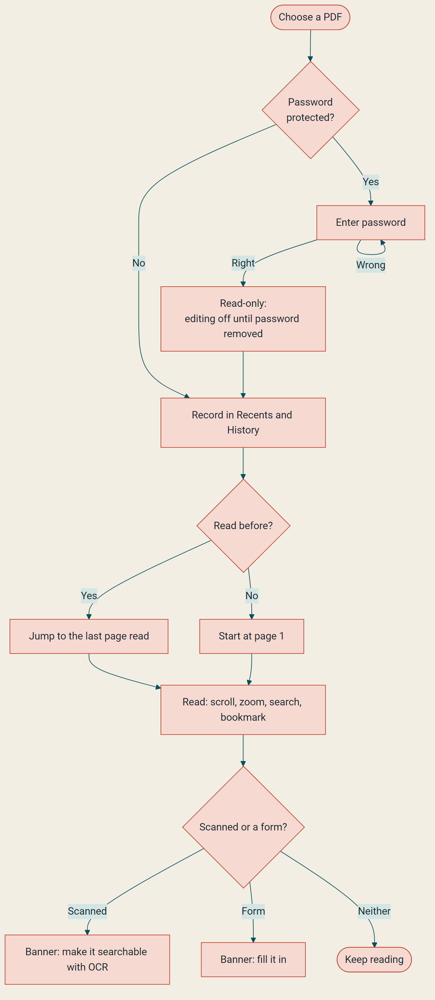

### Reading

| To do this | Do this |
|---|---|
| Zoom | Pinch, double-tap, or the ± buttons |
| Go full-screen | Tap the page once. Tap again to bring the bars back |
| Jump to a page | Drag the page slider at the bottom, or ⋮ → **Go to page** |
| Search | 🔍 at the top. The counter (e.g. `3/27`) opens a list of results; ⌃⌄ move between them |
| Select and copy text | Long-press a word, keep holding and drag. Then Copy, Search, Share or Select whole page |
| Bookmark a page | The bookmark icon at the top |
| Contents, bookmarks, thumbnails | ☰ opens a sheet with three tabs |
| Share | ⋮ → **Share PDF** |
| Use a tool (sign, compress, pages...) | The tool strip at the bottom of the page; **More** for the rest |

**Tools in the reader.** A strip of tools sits at the bottom of every open PDF, so you never have to hunt for them. It shows four tools: first what this file needs (**Fill form** for a form, **Make searchable** for a scan), then the tools you use most on this phone, so it learns your habits. **More** lists the rest. A password-protected file shows **Unlock**. Tap the page to hide the strip for full-screen reading.

  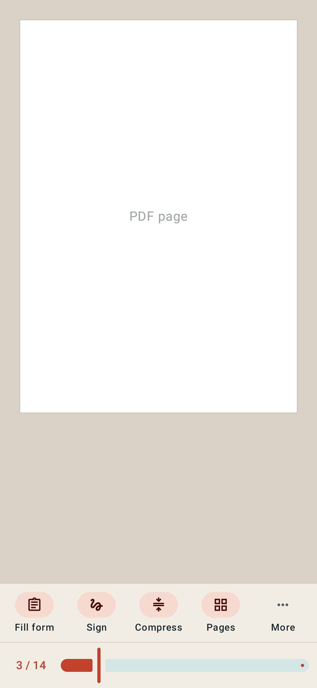
  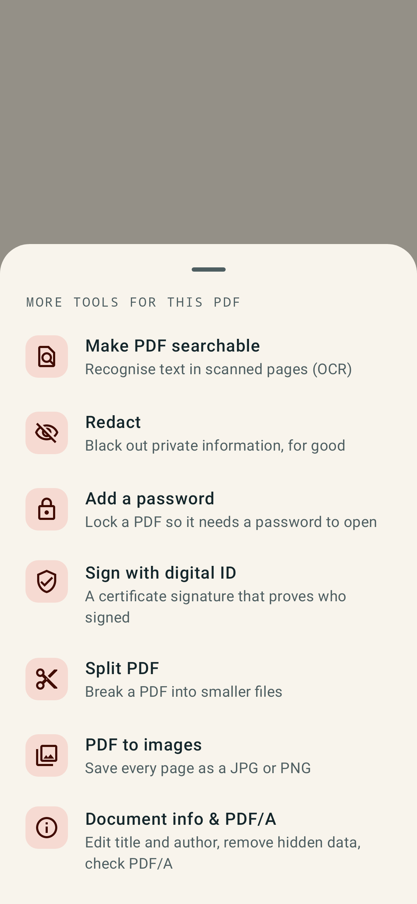

**Reading mode** (⋮ → Reading mode)
- **Scroll**: pages one under another.
- **Pages**: one page at a time; swipe sideways.
- **Text**: just the words, re-flowed to fit the screen, with a text-size slider. Best for small screens and lightest on the battery.
- Colours: **Normal**, **Sepia** or **Night**, plus **Keep screen on**. Vonu remembers your choice.

**Read aloud** (⋮ → Read aloud). The phone reads the document aloud in its own language. It starts at the current page and turns pages as it goes. The bar at the bottom has play/pause, stop and speed (0.8×, 1×, 1.25×, 1.5×). To get more voices, go to Android Settings → Text-to-speech.

**Protected PDFs.** A password-protected PDF asks for its password when you open it. You can read it, but editing stays off until you remove the password (Tools → **Remove a password**). This way a save never strips the protection by accident.

### Annotating and editing

To edit, tap ✏️ in the reader, pick a tool from the bottom bar, then tap 💾 to save. One finger uses the tool; two fingers zoom and move the page. Your edits are saved as standard PDF annotations, so they also show in Adobe Acrobat, Chrome and other readers.

| Tool | How to use it |
|---|---|
| Highlight, Underline, Strike | Drag across text (it snaps to the words) or tap one word. On scanned pages, drag a box |
| Pen | Draw freehand. Pick a colour and thickness |
| Text | Tap where the text should go, then type |
| Image | Pick a photo; it appears in the middle of the page, ready to move |
| Box, Circle, Line, Arrow | Drag from corner to corner, or from start to end |
| Select | Tap anything you added: drag to move, drag the round handle to resize, change colour, edit text, delete |
| Eraser | Tap or rub over anything you added |
| Undo / Redo | Top bar. A whole drag counts as one step; up to 100 steps |
| Sign | Places one of your saved signatures (see below) |

**Saving**
- **Save** writes into the original file. **Save as a copy…** makes a new PDF and opens it.
- If Vonu can't change the original (for example, a file opened from an email), it asks where to save a copy.
- If you leave with unsaved changes, Vonu asks first, so nothing is lost by accident.
- Tools on the reader's tool strip work on the saved file, so save your edits before you use one.

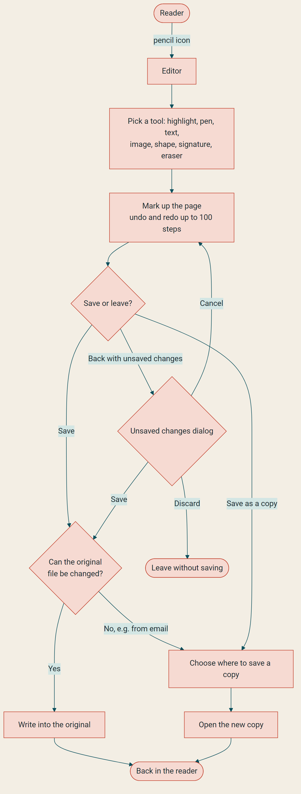

### Signing

**Handwritten signature** (Tools → **Sign a PDF**, or ✏️ → Sign in the reader)
1. Create your signature once. You can **Draw** it with your finger, **Type** your name in a script style, or take a **Photo** of it on paper. With a photo, Vonu removes the paper and keeps only the ink.
2. Your saved signatures and initials stay on the phone.
3. Tap a signature to place it, drag and resize it, then tap 💾 **Save**.

**Digital-ID signature** (Tools → **Sign with digital ID**, or the reader's tool strip → **More**). A digital signature proves who signed, and it shows if the file was changed afterwards.
- **Create** a personal ID, or **import** a `.p12` / `.pfx` file from your employer, a government or a certificate authority.
- Vonu signs to the PAdES standard into a new copy. It never stores your ID's password.
- The same screen also checks existing signatures. It shows whether each one is intact, whether the file was changed after signing, and who issued the certificate.

> **Tip:** sign by hand first, then add the digital signature last. Any change made after a digital signature shows the file as modified.

### Filling forms

Open a form with Tools → **Fill a form**, or tap *Fill it in* on the banner Vonu shows when a PDF contains a form. Every field appears as a simple input, grouped by page. When you're done, choose one of:
- **Save**: writes the answers into the file.
- **Save as a copy**: writes them into a new file.
- **Save a final copy**: flattens the form. The answers become part of the page and show in every app, but you can't change them any more.

### Scanning documents

1. Tools → **Scan documents** → **Start scanning** opens Google's scanner, which finds the edges, straightens and cleans each page.
2. If your phone doesn't have that scanner, use **Take a photo** or **From gallery** instead.
3. Reorder pages with ↑↓ and remove any you don't want.
4. Leave **Make text searchable** on to add OCR. Turn on **Black & white** for whiter paper, darker text and a smaller file.
5. Tap **Save** and choose where the PDF goes.

To make a PDF you already have searchable, use Tools → **Make PDF searchable**. OCR runs on the phone and nothing is uploaded. It reads Latin-script languages such as English, Swahili, French and Spanish.

### All tools

All tools are on the **Tools** tab, and the reader's tool strip shows the ones you use most. Every tool saves a **new file** and leaves your original untouched. The exceptions are Organize pages and Fill a form, which offer to save over the original. When a tool finishes, tap **Open** to read the result.

  
  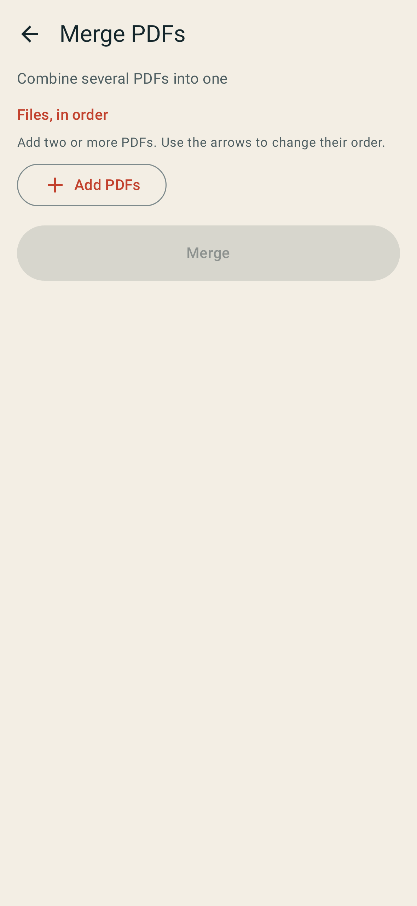

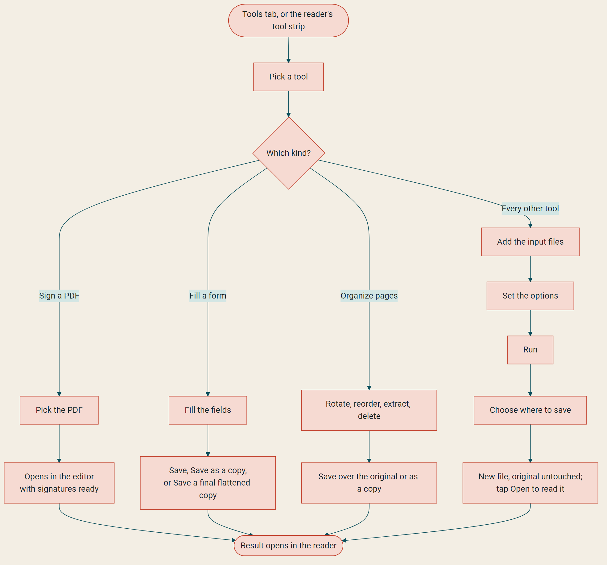

| Tool | What it does | Notes |
|---|---|---|
| Sign a PDF | Adds a handwritten signature or initials | Draw, type or photo |
| Fill a form | Types into a PDF form's fields | Can save a flattened final copy |
| Sign with digital ID | Certificate signature (PAdES) | Also checks existing signatures |
| Scan documents | Camera to a clean, searchable PDF | Works without Play services through photo or gallery |
| Make PDF searchable | OCR on scanned pages | Runs on the phone |
| Merge PDFs | Combines several PDFs into one | Put them in order with ↑↓ |
| Split PDF | Every page, every N pages, or ranges like `1-3, 4-10, 11-` | Shows how many files it will make before starting |
| Organize pages | Rotate, reorder, move, extract or delete pages | Undo works; bookmarks, links and forms are kept |
| Compress PDF | Light, Balanced or Strong | Only pictures are recompressed, so text stays sharp |
| Images to PDF | Photos or screenshots to a PDF | A4, Letter or fit-to-image, with margins |
| PDF to images | Every page as JPG or PNG | Screen, standard or print quality |
| Text to PDF | A `.txt` file to a neat A4 PDF | Most languages work |
| Add a password | AES-256 encryption | Optional limits on printing, copying and editing |
| Remove a password | Saves an unlocked copy | You need to know the password |
| Redact | Blacks out private details for good | Drag boxes, or **Find & mark** every match of a name or number. The hidden text is really removed, not just covered |
| Compare PDFs | Shows what changed between two versions | Text view (red = removed, green = added) and Pages view |
| Batch process | Compress, OCR, protect or clean many PDFs at once | Runs in the background and notifies you when done |
| Document info & PDF/A | Edit title, author and keywords; remove hidden data; PDF/A check | PDF/A *conversion* needs the server |
| Word, Excel, PowerPoint → PDF | Converts Office files | Needs your Vonu server |
| AI assistant | Summaries, questions, tables, translation | Coming in a future update |

### Settings

Open Settings with ⚙ at the top of the Files tab.

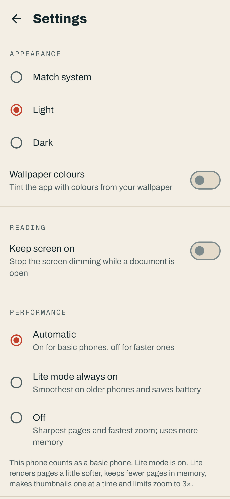

| Setting | Options |
|---|---|
| Appearance | Match system, Light or Dark. Wallpaper colours on Android 12+ (off by default) |
| Reading | Keep screen on |
| Performance | Lite mode: Automatic, Always on or Off. The screen tells you whether this phone counts as basic |
| Vonu server | Address, token, **Test connection**, and a switch that must be on before any document is sent |
| Privacy | Clear recent history (starred files are kept); Forget browse folder |

**Lite mode** is on *Automatic* by default. It switches on when the phone has under 3 GB of RAM or Android reports it as a low-memory phone. In Lite mode, pages are drawn a little less sharp, fewer pages are prepared ahead and the maximum zoom is 3×, so the app stays fast and doesn't crash on big files.

### Privacy and security

- No account, no ads, no tracking. Files never leave the phone unless you share them or turn on the server switch.
- Vonu asks for no storage permission. Android's file picker gives it access only to the files you choose.
- Signatures and digital IDs are stored privately on the phone. A digital ID's password is never saved.
- Unlocked copies of protected PDFs are kept private and deleted when you close them.
- Redaction removes the text, images and links under each box, not just covers them.

### Troubleshooting

| Problem | Fix |
|---|---|
| "This PDF has no searchable text" | It's a scan. Run Tools → **Make PDF searchable**, then search again |
| The scanner says it isn't available | Update Google Play services, or use *Take a photo* / *From gallery* |
| OCR finds no text the first time | The text model downloads once through Play services. Stay online for a minute and try again |
| Read aloud is silent | Install a voice in Android Settings → Text-to-speech, and check the media volume |
| Can't save over a file | The app that shared the file only allowed reading. Use **Save as a copy** |
| Your form answers don't show in Vonu's reader | Save a *final copy*. Other apps show the answers either way |
| *Test connection* to the server fails | Check the phone and computer are on the same Wi-Fi, the IP address is correct, you used `http` (not `https`) for a home server, and the firewall allows port 8000 |

---

## For developers

**Build and run**
1. Install **Android Studio** (Ladybug 2024.2 or newer) with Android SDK 35.
2. *File → Open* → select this folder and let Gradle sync.
3. Plug in a phone (with USB debugging on) or start an emulator, then press **Run ▶**.

Refresh the documentation screenshots with `./gradlew :app:testDebugUnitTest --tests "*DocScreenshots*"` (no device needed).

From the command line, `./gradlew assembleDebug` builds `app/build/outputs/apk/debug/app-debug.apk`. For Google Play, build a signed App Bundle with `./gradlew bundleRelease`.

**Tech stack:** Kotlin, Jetpack Compose and Material 3, built as MVVM. Android's PdfRenderer draws the pages, and PdfBox-Android handles text, annotations, forms and security. BouncyCastle does the digital signatures, and ML Kit does scanning and OCR. Settings are kept in Room and DataStore.

**Optional server:** [`vonu-server/`](vonu-server/README.md) is a small Python FastAPI service, packaged for Docker. It handles Office → PDF, PDF/A conversion, table extraction and, later, AI.

**More detail:**
- [docs/DOCUMENTATION.md](docs/DOCUMENTATION.md): the technical documentation, covering architecture, navigation, project structure, release steps, server setup, screenshots and the test checklist. It's also available as a [Word file](docs/Vonu-PDF-Documentation.docx).
- [PERFORMANCE.md](PERFORMANCE.md): how Vonu stays light on basic phones.
- [branding/](branding/README.md): logo, colours and icons.

## Version history

| Version | Changes |
|---|---|
| Unreleased | Tool strip in the reader: your four most-used tools (plus what the file needs) always visible, the rest under More. UI/UX review: clearer recent-file details, one "Star" wording, bigger section labels, no developer jargon in messages; screenshots and flowcharts in the docs |
| 1.1.2 | New Vonu blue, and the V logo as the app icon and inside the app |
| 1.1.1 | Renamed to Vonu PDF with a new logo; a single app (the debug "Leaks" app is gone); AI assistant marked as coming soon |
| 1.1.0 | Lite mode, Android 7.0+, smaller download, Read aloud, Text view, scanning without the Play scanner, black-and-white scans |
| 1.0 | Vonu server, translation, Office and PDF/A conversion, performance work |
| Earlier | Reader, editing, page tools, signatures, forms, scanning, OCR, passwords, redaction, batch, compare |
