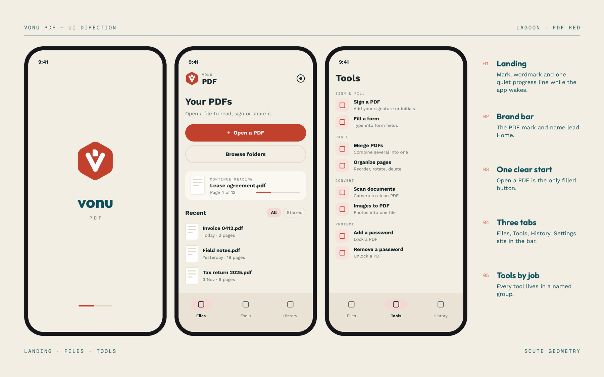

# Vonu PDF brand

The app follows the Vonu identity ("Scute Geometry") from the shared **Vonu Branding** folder
(`README.md`, `PHILOSOPHY.md`, `vonu-brand-book.pdf`). This folder holds only what is specific to Vonu PDF.



## In the app

| Token | Light (Lagoon) | Dark (Reef Night) |
| --- | --- | --- |
| Ground | `#F3EEE4` | `#0D1B2A` |
| Text | `#14262B` | `#E4EEF0` |
| Primary (Vonu PDF hue) | `#C2412D` | `#FFB4A5` |
| Secondary (Lagoon ink) | `#0B4F5C` | `#7FD6CF` |

- The mark is the Vonu hexagon with a white **V** and the **page** signal, on the PDF red.
  Coral is never used in the UI.
- The wordmark is lowercase **vonu** in Outfit Bold (`res/font/outfit_bold.ttf`, OFL, see `fonts/`).
- Navigation is three tabs: **Files**, **Tools**, **History**. Settings is in the Files brand bar.
- A cold launch shows the system splash (Android 12+) and then a short landing screen
  (`ui/components/VonuBrand.kt`). "Open with Vonu" skips it.

## Regenerate

`ic_launcher_foreground.xml`, `ic_launcher_monochrome.xml`, `ic_vonu_mark.xml` and
`vonu-pdf-ui-direction.png` are drawn from the shared generator, never by hand:

```
python -I branding/make_pdf_ui.py "<path to Vonu Branding>"
```

Needs Python 3 with Pillow and the canvas-design fonts. The older blue SVG/PNG files here
(`vonu-*.svg`, `tile.py`) belong to the previous identity and are no longer used by the app.
