# Vonu PDF — Documentation

Nov 7, 2026 · @Esther · updated Nov 19, 2026

## Overview

Vonu PDF (version 1.1.2) is an all-in-one PDF reader and editor for Android that anyone can use, and it runs well even on basic 1–2 GB phones. It is the first product in the Vonu family, which will later include Vonu Write, Vonu Post and Vonu Themes.

Everything runs on the phone. No account is needed, and documents stay on the device. The one exception is optional Office conversion, which uses your own Vonu server.

| Area          | What you can do                                                                                                                                             |
|---------------|-------------------------------------------------------------------------------------------------------------------------------------------------------------|
| Read          | Smooth scrolling or page-by-page, Text view, Sepia and Night colours, search, select and copy text, bookmarks, contents, history and starred files, Read aloud |
| Edit          | Highlight, underline, strike, pen, text, images, shapes, arrows, eraser, undo/redo                                                                          |
| Sign and fill | Handwritten signatures (draw, type or photo), digital-ID signatures (PAdES), fill PDF forms                                                                 |
| Scan          | Camera scanner, plain-camera and gallery fallback, black-and-white clean-up, OCR to make scans searchable                                                   |
| Organise      | Merge, split, reorder, rotate, extract or delete pages, compress, images to PDF, PDF to images, text to PDF                                                 |
| Protect       | Add or remove passwords (AES-256), true redaction, remove hidden data, edit document info, PDF/A check                                                      |
| Advanced      | Compare two versions, batch-process many files, verify signatures, Office to PDF (with the server)                                                          |
| Coming soon   | AI assistant: summaries, questions about a document, table extraction and translation                                                                       |

  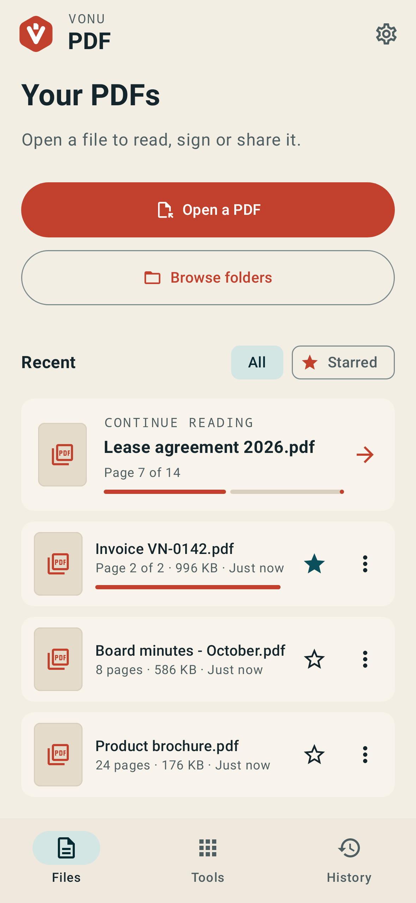
  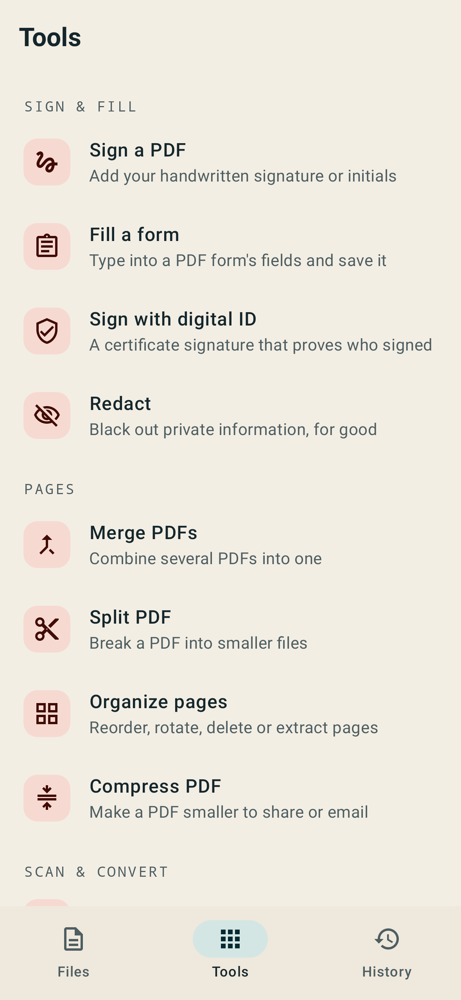
  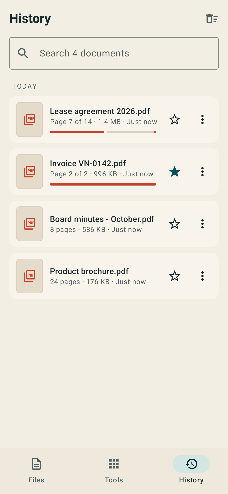
  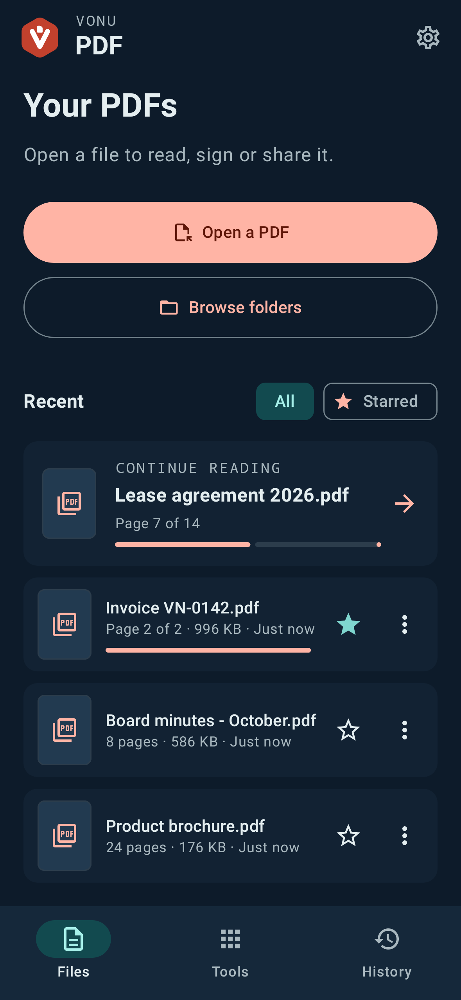

## Installing and requirements

Vonu PDF needs Android 7.0 (API 24) or newer and installs as one app called **Vonu PDF**.

| Requirement          | Details                                                                                                                  |
|----------------------|--------------------------------------------------------------------------------------------------------------------------|
| Android version      | 7.0 (API 24) or newer                                                                                                    |
| Memory               | Works from 1 GB RAM; Lite mode turns on by itself on basic phones                                                        |
| Storage permission   | None. Files are opened through Android's file picker, so Vonu only sees files you choose                                 |
| Internet             | Only for the one-time download of the OCR and language models (through Google Play services) and for the optional server |
| Notifications        | Asked once, so batch jobs can say when they finish                                                                       |
| Google Play services | Needed for the automatic document scanner and OCR. Without it, scanning still works with Take a photo or From gallery    |

**Install from Android Studio (testing)**

1.  Unzip the project and open the Vonu folder with **File → Open**.

2.  Click **Sync Now** and wait for Gradle to finish.

3.  Turn on **USB debugging** on the phone (Settings → About phone → tap *MIUI/Build number* 7 times → Additional settings → Developer options).

4.  Plug the phone in, pick it in the device list and press the green **Run** button.

5.  If an older Folio, Lumo or "Leaks" app is on the phone, uninstall it first. Vonu installs as its own app (com.vonu.pdf).

**Install for clients**

Build a signed release with **Build → Generate Signed App Bundle / APK**. Upload the App Bundle (.aab) to Google Play; Play delivers a small APK made for each phone. To share directly, build an APK; Vonu makes one per CPU type (arm64-v8a suits almost all modern phones, armeabi-v7a suits older ones).

## Screens and navigation

The app has three bottom tabs. Every other screen opens on top of them without the tab bar, and Back returns to where you were. A short landing screen (mark and wordmark) shows on a cold start only; "Open with Vonu PDF" from another app skips it and goes straight to the reader.

| Screen            | Route                              | Reached from                                                          |
|-------------------|------------------------------------|-----------------------------------------------------------------------|
| Files (tab)       | `home`                             | Start destination                                                     |
| Tools (tab)       | `tools`                            | Tab bar                                                               |
| History (tab)     | `history`                          | Tab bar                                                               |
| Folder browser    | `browser`                          | Files → Browse folders                                                |
| Settings          | `settings`                         | Files → ⚙                                                             |
| Tool screen       | `tool/{kind}?uri={uri}`            | Tools tab, or the reader's ⋮ menu (with the open file)                |
| Reader and editor | `viewer?uri={uri}&action={action}` | Any file; `action=sign` opens straight into the editor's signatures |

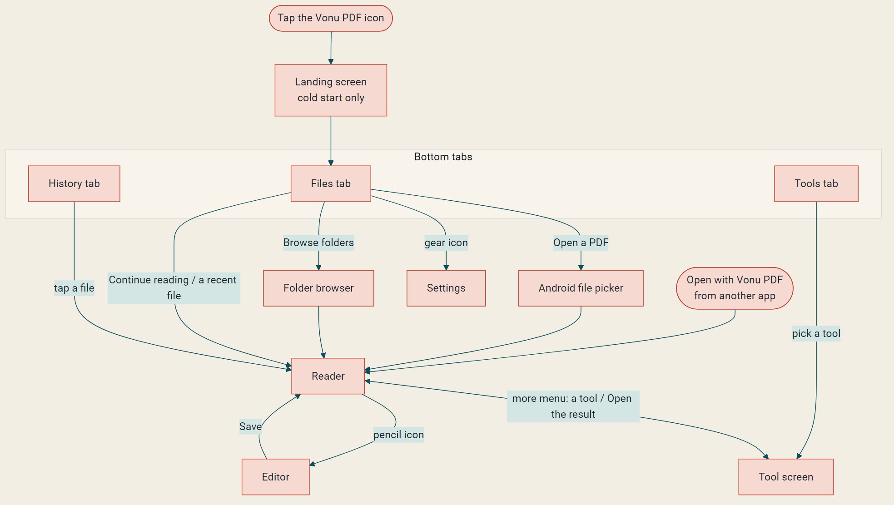

| Landing | Files | Tools | Merge (a tool) | History | Settings |
|---|---|---|---|---|---|
|  |  |  | 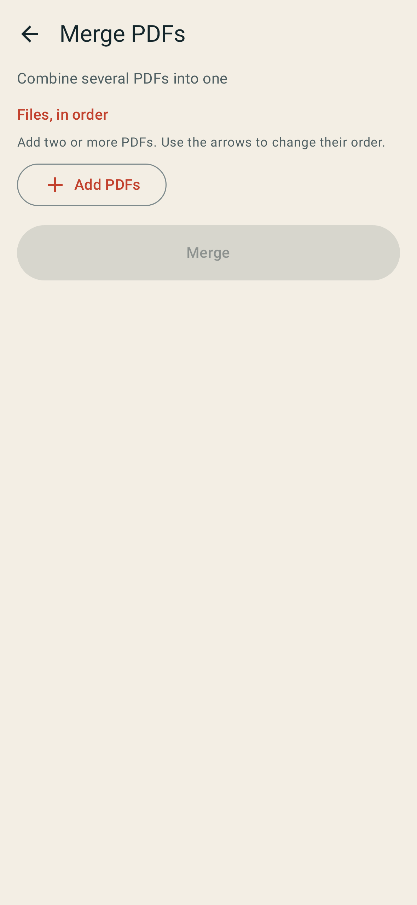 |  | 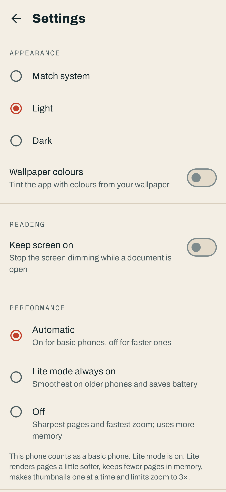 |

## User guide: reading

Open a PDF from **Files → Open a PDF**, from **Files → Browse folders**, or by tapping a PDF in any other app (Files, WhatsApp, email) and choosing Vonu PDF.

**Files tab**

- **Open a PDF** (Android's file picker) and **Browse folders** (pick a folder once and Vonu lists its PDFs).

- **Continue reading** jumps back to the last page you were on. Below it, recent files show where you are (or how many pages), the size and when you opened them; a progress bar appears once you've started reading.

- Tap ☆ to **star** a file; the **Starred** filter shows only starred files. The **History** tab lists everything you opened, grouped by day and searchable.

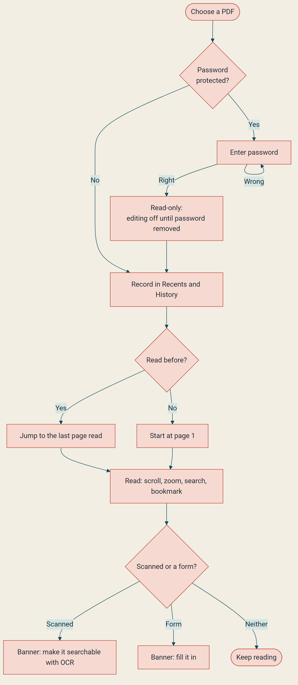

**In the reader**

| To do this                      | Do this                                                                                 |
|---------------------------------|-----------------------------------------------------------------------------------------|
| Zoom                            | Pinch, double-tap, or the ± buttons                                                     |
| Go full-screen                  | Tap the page once; tap again to bring the bars back                                     |
| Jump to a page                  | Drag the page slider at the bottom, or ⋮ → Go to page                                   |
| Search                          | 🔍 at the top. The counter (e.g. 3/27) opens a list of results; ⌃⌄ move between them    |
| Select and copy text            | Long-press a word, keep holding and drag. Then Copy, Search, Share or Select whole page |
| Bookmark a page                 | The bookmark icon at the top                                                            |
| Contents, bookmarks, thumbnails | ☰ opens a sheet with three tabs                                                         |
| Share                           | ⋮ → Share PDF                                                                           |

**Reading mode** (⋮ → Reading mode)

- **Scroll**: pages one under another.

- **Pages**: one page at a time; swipe sideways.

- **Text**: just the words, re-flowed to the screen, with a text-size slider. Best for small screens and lightest on the battery.

- Colours: **Normal**, **Sepia** or **Night**. Plus **Keep screen on**. Your choice is remembered.

**Read aloud** (⋮ → Read aloud)

The phone reads the document in its own language, starting at the current page, and turns pages as it goes. A bar at the bottom has play/pause, stop and speed (0.8×, 1×, 1.25×, 1.5×). It uses the phone's text-to-speech voice; install more voices in Android's Settings → Text-to-speech.

**Protected PDFs**

A password-protected PDF asks for its password when opened. You can read it, but editing stays off until you remove the password (Tools → Remove a password), so a save never strips the protection by accident.

## User guide: annotating and editing

Tap ✏️ in the reader to open the editor, pick a tool from the bar at the bottom, then tap 💾 to save. Everything you add is saved as standard PDF annotations, so it shows in Adobe Acrobat, Chrome and other readers.

| Tool                         | How to use it                                                                                           |
|------------------------------|---------------------------------------------------------------------------------------------------------|
| Highlight, Underline, Strike | Drag across text (it snaps to the words) or tap one word. On scanned pages, drag a box                  |
| Pen                          | Draw freehand. Pick a colour and thickness                                                              |
| Text                         | Tap where the text should go, then type                                                                 |
| Image                        | Pick a photo or picture; it lands in the middle of the page, ready to move                              |
| Box, Circle, Line, Arrow     | Drag from corner to corner, or from start to end                                                        |
| Select                       | Tap anything you added: drag to move, drag the round handle to resize, change colour, edit text, delete |
| Eraser                       | Tap or rub over anything you added                                                                      |
| Undo / Redo                  | Top bar. A whole drag is one step; up to 100 steps                                                      |
| Sign                         | Places one of your saved signatures (see the next section)                                              |

**Saving**

- **Save** writes into the original file.

- **Save as a copy…** makes a new PDF and opens it.

- If Vonu can't change the original (for example, a file opened from an email), it asks where to save a copy.

- Leaving with unsaved changes asks first, so nothing is lost by accident.

- Tools from the reader's ⋮ menu work on the saved file, so save your edits before using one.

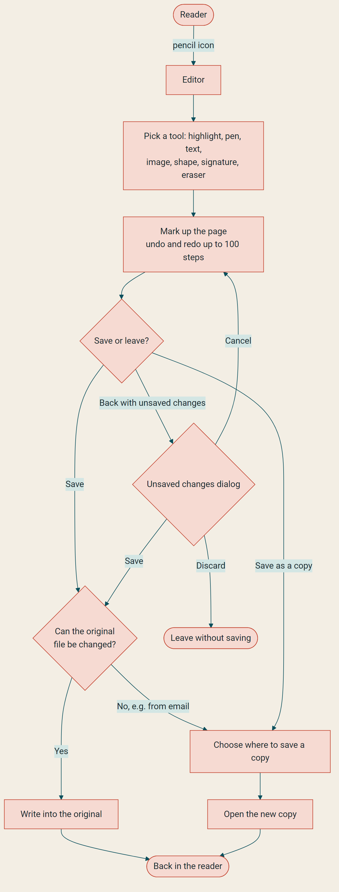

## User guide: signing, forms and scanning

**Handwritten signatures** (Tools → Sign a PDF, or ✏️ → Sign)

1.  Create a signature once: **Draw** it with your finger, **Type** your name in a script style, or take a **Photo** of it on paper. With a photo, Vonu removes the paper and keeps the ink.

2.  Saved signatures and initials stay on the phone.

3.  Tap one to place it, drag and resize it, then tap 💾 Save.

**Digital-ID signatures** (Tools → Sign with digital ID, or ⋮ in the reader)

A digital signature proves who signed and shows if the file changed afterwards.

- **Create** a personal ID (a self-signed RSA-2048 certificate) or **import** a .p12 / .pfx file from your employer, a government or a certificate authority.

- Vonu signs to the PAdES standard (SHA-256) into a new copy. The ID's password is never stored.

- The same screen checks existing signatures: intact or broken, whether the file changed after signing, and who issued the certificate.

**Fill a form** (Tools → Fill a form, or *Fill it in* on the banner)

Every field appears as a simple input (text, check box, choice, drop-down), grouped by page. Then choose **Save**, **Save as a copy**, or **Save a final copy**. A final copy is flattened: the answers become part of the page and show in every app, but can no longer be changed.

**Scan documents** (Tools → Scan documents)

1.  **Start scanning** opens Google's scanner, which finds the edges, straightens and cleans each page.

2.  On phones without it, use **Take a photo** (any camera app) or **From gallery**.

3.  Reorder pages with ↑↓ and remove any you don't want.

4.  Leave **Make text searchable** on to add OCR. Turn on **Black & white** for whiter paper, darker text and a smaller file.

5.  Tap **Save** and choose where the PDF goes.

**Make an existing PDF searchable** (Tools → Make PDF searchable)

OCR adds an invisible text layer to scanned pages, so search, selection and copy work on them. It runs on the phone and nothing is uploaded. It reads Latin-script languages such as English, Swahili, French and Spanish.

## Tools reference

All tools are on the **Tools** tab, grouped as Sign & fill, Pages, Scan & convert, Protect and More; the most useful ones are also in the reader's ⋮ menu (for a locked file, only Remove a password). Every tool saves a new file and leaves the original untouched, except Organize and Fill a form, which offer to save over it. When a tool finishes, **Open** shows the result in the reader.

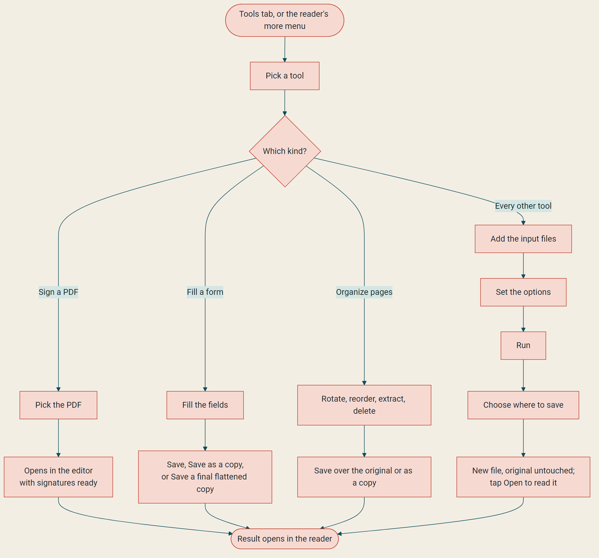

| Tool                          | What it does                                             | Notes                                                                                            |
|-------------------------------|----------------------------------------------------------|--------------------------------------------------------------------------------------------------|
| Sign a PDF                    | Adds a handwritten signature or initials                 | Draw, type or photo                                                                              |
| Fill a form                   | Types into a PDF form's fields                           | Can flatten into a final copy                                                                    |
| Scan documents                | Camera to clean, searchable PDF                          | Works without Play services through photo or gallery                                             |
| Make PDF searchable           | OCR on scanned pages                                     | On-device                                                                                        |
| Sign with digital ID          | Certificate signature (PAdES)                            | Also verifies existing signatures                                                                |
| Add a password                | AES-256 encryption                                       | Optional limits on printing, copying, editing                                                    |
| Remove a password             | Saves an unlocked copy                                   | You must know the password                                                                       |
| Redact                        | Blacks out private details for good                      | Drag boxes or Find & mark every match. Marked pages become images, so hidden text is really gone |
| Compare PDFs                  | Shows what changed between two versions                  | Text view (red removed, green added) and Pages view                                              |
| Batch process                 | Compress, OCR, protect or clean many PDFs                | Runs in the background, notifies when done                                                       |
| Document info & PDF/A         | Title, author, keywords; remove hidden data; PDF/A check | PDF/A conversion needs the server                                                                |
| Merge PDFs                    | Combines several PDFs into one                           | Order with ↑↓                                                                                    |
| Split PDF                     | Every page, every N pages, or ranges like 1-3, 4-10, 11- | Shows how many files before starting                                                             |
| Organize pages                | Rotate, reorder, move, extract or delete pages           | Undo works; bookmarks, links and forms kept                                                      |
| Compress PDF                  | Light, Balanced or Strong                                | Only pictures are recompressed; text stays sharp                                                 |
| Images to PDF                 | Photos or screenshots to a PDF                           | A4, Letter or fit-to-image, margins                                                              |
| PDF to images                 | Every page as JPG or PNG                                 | Screen, standard or print quality                                                                |
| Text to PDF                   | A .txt file to a neat A4 PDF                             | Most languages work                                                                              |
| Word, Excel, PowerPoint → PDF | Converts Office files                                    | Needs your Vonu server                                                                           |
| AI assistant                  | Summaries, questions, tables, translation                | Coming in a future update                                                                        |

## Settings, Lite mode, privacy and security

**Settings** (Files → ⚙)

| Setting     | Options                                                                                    |
|-------------|--------------------------------------------------------------------------------------------|
| Appearance  | Match system, Light or Dark; Wallpaper colours on Android 12+                              |
| Reading     | Keep screen on                                                                             |
| Performance | Lite mode: Automatic, Always on or Off. The screen says whether this phone counts as basic |
| Vonu server | Address, token, Test connection, and a switch that must be on before any document is sent  |
| Privacy     | Clear recent history (starred files are kept); Forget browse folder                           |

**Lite mode**

Automatic is the default. It turns on when Android reports a low-RAM phone, the app's memory allowance is 192 MB or less, or the phone has under 3 GB of RAM.

|                         | Lite               | Normal    |
|-------------------------|--------------------|-----------|
| Page sharpness          | 1.25× screen       | 2× screen |
| Largest page image      | 5 MP               | 12 MP     |
| Page cache              | 1/14 of app memory | 1/8       |
| Pages prepared ahead    | 1                  | 2         |
| Thumbnails made at once | 1                  | 2         |
| OCR image width         | 1,700 px           | 2,600 px  |
| Maximum zoom            | 3×                 | 5×        |

**Privacy and security**

- No account, no ads, no tracking. Files never leave the phone unless you share them or turn on the server switch.

- Vonu asks for no storage permission; Android's picker gives it access only to the files you choose.

- Signatures and digital IDs are stored privately on the phone. A digital ID's password is never saved.

- Unlocked copies of protected PDFs are private and deleted when you close them.

- Redaction removes the hidden text, images and links under each box, not just covers them.

- Use https:// for a server outside your home network. Vonu warns you when an address is plain http://.

## Developer guide

Vonu PDF is a native Kotlin app built with Jetpack Compose using MVVM: each screen watches one StateFlow from its ViewModel, and all PDF work runs on the phone.

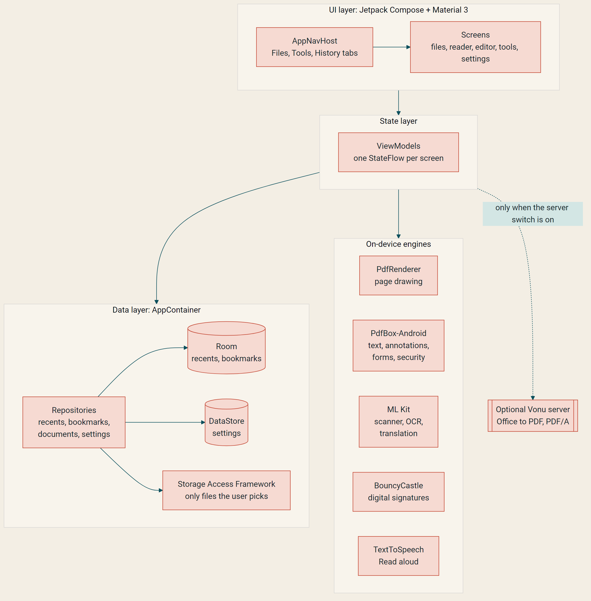

The dotted line is the only path that leaves the phone, and only when the server switch in Settings is on.

**Tech stack**

| Part                     | Choice                                                                 | Version                  |
|--------------------------|------------------------------------------------------------------------|--------------------------|
| Language                 | Kotlin                                                                 | 2.1.0                    |
| UI                       | Jetpack Compose + Material 3                                           | Compose BOM 2024.12.01   |
| Build                    | Android Gradle Plugin, KSP                                             | AGP 8.7.3                |
| Storage                  | Room (recents, bookmarks), DataStore (settings)                        | Room 2.6.1               |
| Rendering                | Android PdfRenderer                                                    | built in                 |
| Editing, forms, security | PdfBox-Android                                                         | 2.0.27.0                 |
| Digital signatures       | BouncyCastle (jdk15to18)                                               | 1.78.1                   |
| Scanning and OCR         | ML Kit document scanner, text recognition, language ID (Play services) | 16.0.0 / 19.0.1 / 17.0.0 |
| Read aloud               | Android TextToSpeech                                                   | built in                 |
| Server                   | Python, FastAPI, Docker                                                | see the server section   |

**Project structure** (app/src/main/java/com/vonu/pdf/)

| Folder                    | Holds                                                                                                                                                             |
|---------------------------|-------------------------------------------------------------------------------------------------------------------------------------------------------------------|
| ui/                       | Compose screens and ViewModels: home, browser, history, viewer, editor, sign, forms, tools, redact, compare, batch, metadata, settings, assistant, theme          |
| pdf/                      | The PDF engine: PdfFile (rendering and cache), text extraction and search, annotations I/O, page tools, OCR PDF, forms, security, redaction, metadata, thumbnails |
| edit/                     | Annotation model and the editor with undo/redo                                                                                                                    |
| data/                     | Repositories for recents, bookmarks, documents and settings; the Room database                                                                                    |
| sign/                     | Signature store, digital IDs, signature checks                                                                                                                    |
| ocr/, translate/, speech/ | ML Kit text recognition, translation, Read aloud                                                                                                                  |
| batch/, compare/          | Background batch runner; text diff and page compare                                                                                                               |
| net/                      | VonuServer, the client for the optional server                                                                                                                    |
| navigation/               | Routes and the nav host                                                                                                                                           |
| util/                     | DeviceProfile (Lite mode), Features (feature switches), Reflow, image and format helpers                                                                          |
| VonuApp.kt                | App start-up: wires the AppContainer, applies Lite mode, trims memory                                                                                             |

**Feature switches**

util/Features.kt holds features that are built but not shipped. AI_ASSISTANT = false hides the assistant from the Tools tab and the reader menu (ToolKind.available filters it out, and an old link to it just goes back). Set it to true to release it.

**UI design system**

The theme lives in ui/theme/Theme.kt; brand pieces (VonuBrandTitle, BrandLabel, VonuLanding) in ui/components/VonuBrand.kt.

| Token                | Light                | Dark (Reef Night) | Used for                                   |
|----------------------|----------------------|-------------------|--------------------------------------------|
| primary              | #C2412D (PDF red)    | #FFB4A5           | Main buttons, progress, selected radio     |
| secondary / tertiary | #0B4F5C (Lagoon ink) | #7FD6CF           | Wordmark, stars, selected chips and tabs   |
| background / surface | #F3EEE4              | #0D1B2A           | Screen ground                              |
| surfaceContainerLow  | #F8F4EC              | #122233           | Cards                                      |
| onSurfaceVariant     | #4E5E61              | #A9B8BF           | Secondary text (at least 4.5:1 on ground)  |

- Wordmark: Outfit Bold, lowercase "vonu". Everything else uses the Material 3 type scale.

- Section labels (Tools groups, History days, Settings sections, "Continue reading") use BrandLabel: 12 sp monospace, upper case, marked as headings for TalkBack.

- One word for favourites in the UI: **Star / Starred**.

- User-facing messages never mention build phases; when something is missing, they point to the tool that fixes it.

- Wallpaper colours (dynamic colour) are opt-in on Android 12+.

**UI/UX review (Nov 19, 2026)**

A review against the ui-ux-pro-max checklist (accessibility, touch targets, consistency, copy) found and fixed:

| Finding                                                                          | Fix                                                                               |
|----------------------------------------------------------------------------------|-----------------------------------------------------------------------------------|
| Messages said "OCR arrives in Phase 5", "Phase 6", "Phase 7" though these ship    | Point to Tools → Make PDF searchable, Remove a password, or the Office tool       |
| "Starred" chip, but "favourites" in buttons, menus, toasts and dialogs           | Star / Starred everywhere                                                         |
| Brand labels at 10 sp, below the 12 sp minimum                                   | 12 sp; Settings and History headers use the same label as Tools                   |
| Recent cards said "0 min. ago" and the line was cut off                          | "Just now"; page count until reading starts                                       |
| Every new file showed an almost empty progress bar                               | Bar only once reading has started                                                 |
| Section headers not announced as headings                                        | heading() semantics on Tools, History and Settings sections                       |

**Build and release**

1.  Raise versionCode and versionName in app/build.gradle.kts (now 10 and 1.1.2).

2.  **Build → Generate Signed App Bundle / APK**, and create a keystore the first time. Keep the keystore and its passwords safe: Play updates need the same key.

3.  Release builds run R8 shrinking with the rules in app/proguard-rules.pro.

4.  ABI splits make one APK per CPU type (armeabi-v7a, arm64-v8a, x86_64); Play handles this for App Bundles.

5.  The package name is com.vonu.pdf. Changing it later makes a different app on Play.

## Vonu server

The Vonu server (vonu-server/) is an optional Python FastAPI service that you run yourself. It handles the jobs a phone can't do well: Office conversion and PDF/A today, and AI when that update ships. The app works fully without it.

| Endpoint        | Does                                                    | Needs                                |
|-----------------|---------------------------------------------------------|--------------------------------------|
| GET /health     | Reports which features this server has                  | Nothing                              |
| POST /convert   | Word, Excel, PowerPoint → PDF                           | LibreOffice on the server            |
| POST /pdfa      | Converts to PDF/A and reports veraPDF validation        | Ghostscript (veraPDF optional)       |
| POST /tables    | Extracts tables as CSV or Excel                         | pdfplumber (included)                |
| POST /summarize | Summaries with page references                          | An AI model (coming soon in the app) |
| POST /ask       | Answers questions from the document, with page snippets | An AI model (coming soon in the app) |

Every endpoint except /health needs the token, sent as Authorization: Bearer \<token\>.

**Run it with Docker (recommended)**

cd vonu-server  
cp .env.example .env \# set VONU_TOKEN to a long random value  
docker compose up -d --build

**Run it with Python (Windows, in Android Studio's Terminal)**

cd vonu-server  
python -m venv .venv  
.venv\Scripts\activate  
pip install -r requirements.txt  
\$env:VONU_TOKEN = "pick-a-long-secret-word"  
\$env:LLM_PROVIDER = "none"  
uvicorn app.main:app --host 0.0.0.0 --port 8000

**Configuration** (environment variables)

| Variable          | Meaning                                                                  | Default                            |
|-------------------|--------------------------------------------------------------------------|------------------------------------|
| VONU_TOKEN        | Shared secret the app sends                                              | empty (no check; testing only)     |
| LLM_PROVIDER      | openai (any OpenAI-compatible API, including Ollama), anthropic, or none | openai                             |
| LLM_BASE_URL      | Address of the model API                                                 | http://localhost:11434/v1 (Ollama) |
| LLM_MODEL         | Model name                                                               | llama3.1:8b                        |
| LLM_API_KEY       | Key for a hosted model                                                   | empty                              |
| LLM_TIMEOUT       | Seconds to wait for the model                                            | 180                                |
| MAX_CONTEXT_CHARS | Text per model call; longer documents are done in parts                  | 24000                              |
| MAX_UPLOAD_MB     | Largest file accepted                                                    | 60                                 |

**Connect the app**

1.  Put the phone and computer on the same Wi-Fi. Find the computer's IPv4 address with ipconfig, for example 192.168.1.20.

2.  In Vonu: Settings → Vonu server → address http://192.168.1.20:8000, then the token → **Test connection**.

3.  Turn on the switch that allows sending documents to your server.

4.  Outside your home network, put the server behind HTTPS (for example Caddy or a Cloudflare Tunnel).

## Performance, testing and troubleshooting

**How Vonu stays light**

- Device-aware limits through DeviceProfile (Lite mode table above).

- Page bitmaps live in a small LRU cache that is emptied when Android reports low memory.

- Thumbnails are cached on disk and kept in memory at half size (RGB_565).

- Text positions are packed into 16-bit numbers, about a quarter of the memory for long documents.

- Nearby pages are prepared ahead, and a Baseline Profile speeds up the first launch.

- StrictMode in debug builds flags files left open and network calls on the main thread.

**Documentation screenshots**

The screenshots in this document and the README are rendered from the real app, not mock-ups, by a JVM test, so no phone or emulator is needed.

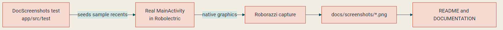

1.  Run `./gradlew :app:testDebugUnitTest --tests "*DocScreenshots*"`.

2.  app/src/test/java/com/vonu/pdf/DocScreenshots.kt starts MainActivity under Robolectric (native graphics, a 393×852 dp phone), seeds four sample recent files, taps through the tabs and captures each screen with Roborazzi.

3.  The PNGs land in docs/screenshots/. Commit them with the UI change.

The reader itself can't be captured this way, because PdfRenderer has no JVM implementation. The flowcharts are Mermaid files in docs/flowcharts/ (*.mmd); re-render one with `npx @mermaid-js/mermaid-cli -i 1-navigation.mmd -o 1-navigation.png -c config.json -b "#F3EEE4" -s 2`.

**Test checklist before a release**

- [ ] Only one app icon, "Vonu PDF", appears after installing

- [ ] Open a 200+ page PDF on a 2 GB phone; scroll fast to the end and back without a crash

- [ ] Search, select and copy text; add a bookmark; reopen and land on the same page

- [ ] Highlight, pen, text and shapes; save; reopen in another PDF app and see them

- [ ] Sign with a drawn signature and with a digital ID; check the signature shows as intact

- [ ] Fill a form and save a final copy

- [ ] Scan two pages with Take a photo and Black & white on; the PDF is searchable

- [ ] Merge, split, compress and organize a test file

- [ ] Protect a file, open it with the password, then remove the password

- [ ] Redact a name with Find & mark; search the result and find nothing

- [ ] Read aloud: pause, resume, speed, and page turns work

- [ ] Text view: the text-size slider works

- [ ] Settings → Performance says the right thing on an older phone

- [ ] Neither the Tools tab nor the reader menu shows the AI assistant

- [ ] Files, Tools and History keep their scroll position when you switch tabs

- [ ] TalkBack reads section labels as headings and every icon button by name

- [ ] Install on Android 7 (API 24)

**Troubleshooting**

| Problem                              | Fix                                                                                                    |
|--------------------------------------|--------------------------------------------------------------------------------------------------------|
| A second "Leaks" app is on the phone | It came from an older debug build. Uninstall it; 1.1.1 no longer adds it                               |
| Green Run button is greyed out       | Click **Sync Now** (or File → Sync Project with Gradle Files), then pick the phone in the device list  |
| "Duplicate class" build error        | Leftover files from an old folder. Start from a fresh unzip and copy in only .git and local.properties |
| "This material API is experimental"  | Add @OptIn(ExperimentalMaterial3Api::class) above the function, or at the top of the file              |
| Scanner says it isn't available      | Update Google Play services, or use Take a photo / From gallery                                        |
| OCR finds no text the first time     | The text model downloads once through Play services; stay online a minute and try again                |
| Read aloud is silent                 | Install a voice in Android Settings → Text-to-speech, and check the media volume                       |
| Can't save over a file               | The file came from an app that only lends read access; use Save as a copy                              |
| Test connection fails                | Same Wi-Fi, correct IP, http not https on a home server, firewall allows port 8000                     |

## Roadmap and version history

**Next**

- Release the AI assistant (summaries, questions, tables, translation) by setting AI_ASSISTANT = true once the server is hosted.

- Host the Vonu server behind HTTPS so clients don't need to run their own.

- Publish on Google Play under com.vonu.pdf, after checking the name in Kenya (KIPI) and WIPO and registering a domain.

- Start the next Vonu products: Write, Post and Themes, using the same tile-and-light icon style from the branding/ folder.

**Version history**

| Version       | Date       | Changes                                                                                                                |
|---------------|------------|------------------------------------------------------------------------------------------------------------------------|
| Unreleased    | 19 Nov 2026 | UI/UX review fixes (see Developer guide); screenshots and flowcharts in the docs                                       |
| 1.1.2         | Nov 2026   | Vonu identity, Files / Tools / History tabs, landing screen, V logo app icon                                           |
| 1.1.1         | 7 Nov 2026 | Renamed to Vonu PDF with a new logo; one app only (LeakCanary removed); AI assistant marked as coming soon             |
| 1.1.0         | 6 Nov 2026 | Lite mode; Android 7.0+; smaller download; Read aloud; Text view; scanning without Play scanner; black-and-white scans |
| 1.0 (phase 7) | Nov 2026   | Vonu server, AI assistant (now held back), translation, Office and PDF/A conversion, performance work                  |
| Phase 6       | Nov 2026   | Passwords, redaction, batch jobs, compare, document info, PDF/A check, signature check                                 |
| Phase 5       | Nov 2026   | Handwritten and digital signatures, forms, camera scanner, OCR                                                         |
| Phase 4       | Nov 2026   | Merge, split, organize, compress, images and text to PDF, PDF to images                                                |
| Phase 3       | Nov 2026   | Annotations and editing with undo/redo and saving                                                                      |
| Phase 2       | Nov 2026   | Search, selection, bookmarks, contents, reading modes, history and favourites                                          |
| Phase 1       | Nov 2026   | App foundation: home, file opening, smooth rendering                                                                   |
